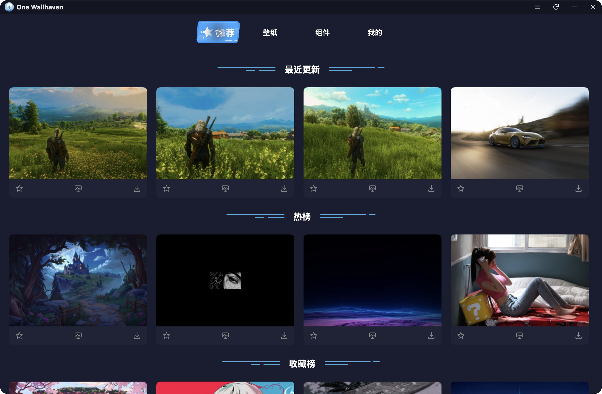
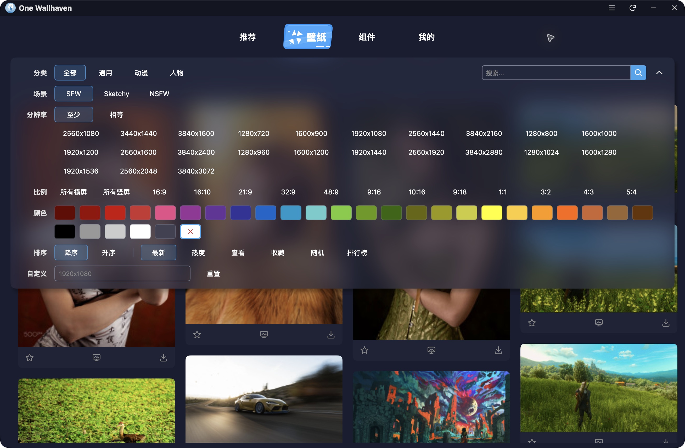
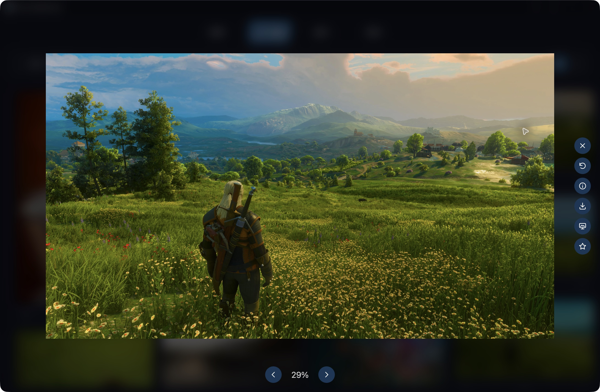

<h1 align="center">MyGO Wallhaven</h1>

<div align="center">一款基于 Go / MyGO 原生 UI 的壁纸客户端。</div>

## 运行

```sh
go mod download # 安装依赖
make dev        # 开发
make check      # 检查
make build      # 打包
```

自动更新与 GitHub Releases 发布配置见 [发布说明](docs/releases.md)。

## 图片缓存

缩略图与原图先读取内存缓存，再读取磁盘缓存，未命中时才下载图片。磁盘缓存位于系统用户缓存目录下的 `mygo-wallhaven/images-v1`，重启应用后仍可复用。

缩略图磁盘缓存默认上限为 256MiB，原图为 1GiB。设置窗口可查看占用、刷新统计、清理磁盘缓存或分别调整容量；容量选择会保存，调小后立即淘汰最久未使用的缓存。清理不影响已下载的壁纸和当前显示的内存图片。

设置窗口默认 560×620，可调整大小，作为主窗口的非模态子窗口显示；macOS 使用 AppKit 原生父子关联来维持窗口层级。损坏缓存会重新下载，缓存目录不可写时继续使用内存和网络。搜索、详情等元数据仍通过 Wallhaven API 获取。

## 截图







## API

[Wallhaven API](https://wallhaven.cc/help/api)

## LICENSE

[MIT LICENSE](LICENSE)
