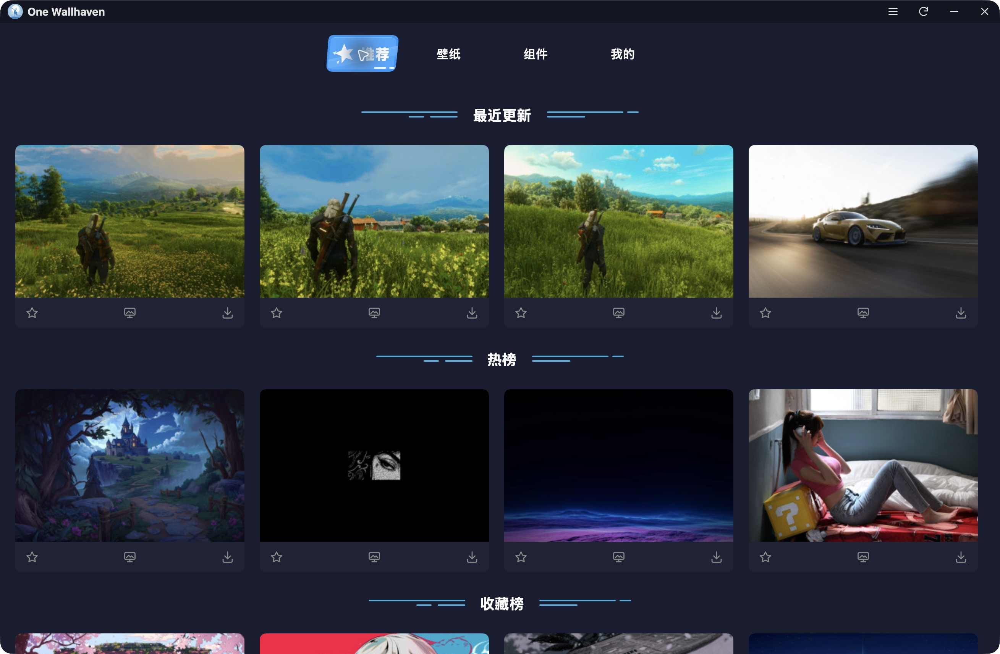
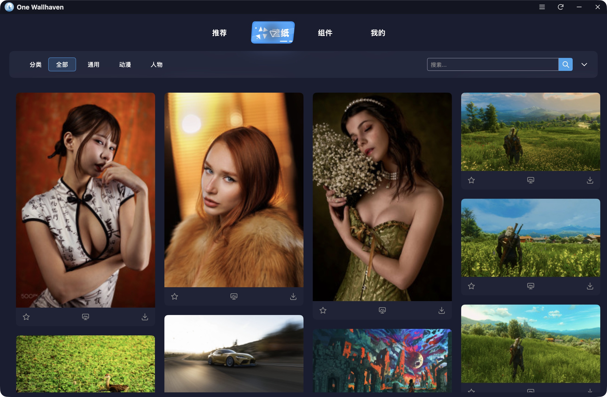
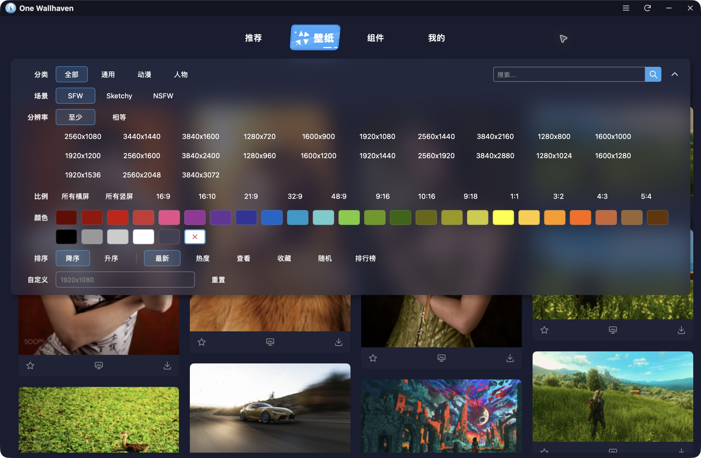
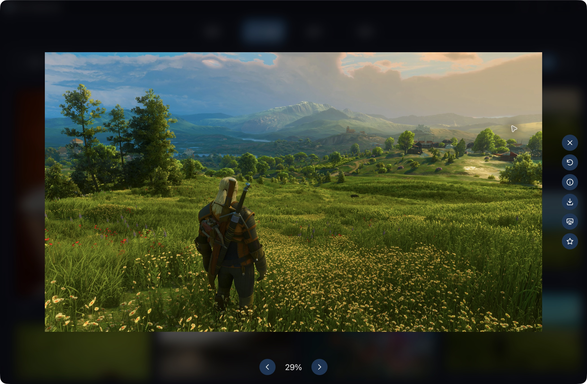
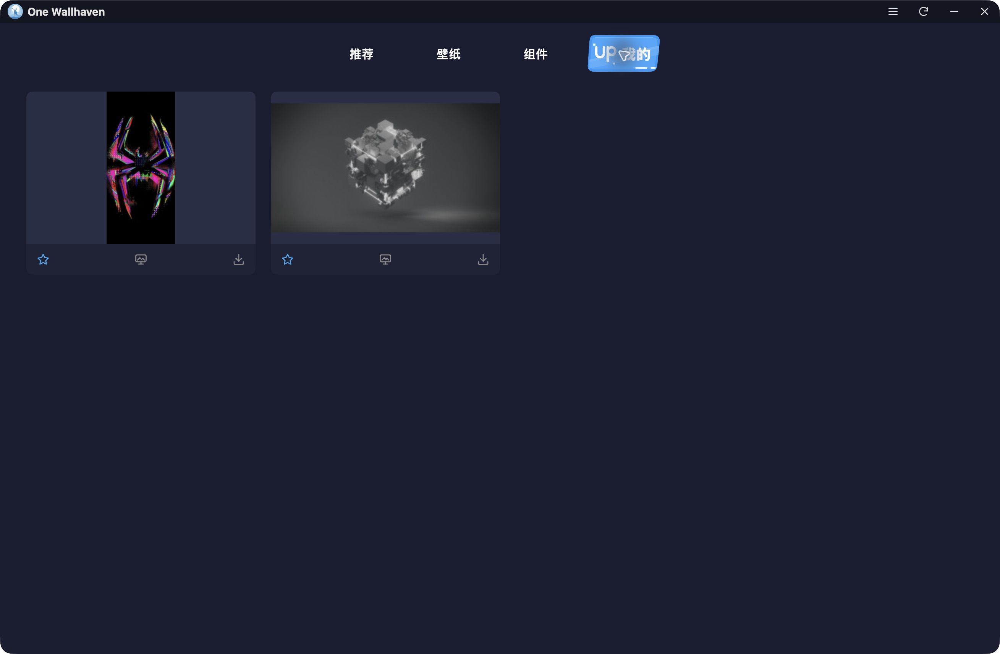

<h1 align="center">MyGO Wallhaven</h1>

<div align="center">
一款基于 Go / MyGO 原生 UI 的壁纸客户端，沿用 wallhaven-electron 的界面布局与素材。
</div>

## 运行

需要 Go `1.27.3`，MyGO 版本由 `go.mod` 固定，无需 Node 或前端构建。

```sh
# 安装依赖
go mod download

# 运行开发模式
make dev

# 检查
make check

# 打包应用
make build
```

macOS 开发与构建统一使用 ad-hoc 签名。直接调用 MyGO CLI 时必须显式传入 `-sign -`，不能仅依赖 `mygo.json`。应用包输出到 `build/darwin-arm64/MyGO Wallhaven.app`。

默认下载到系统下载目录的 `MyGO Wallhaven` 文件夹，可在下载页或设置中修改。收藏、设置及下载状态保存在用户配置目录的 `mygo-wallhaven` 子目录。

## 桌面预览

打开壁纸大图后，点击工具栏中的“桌面预览”。macOS 会临时隐藏其他普通应用，在系统壁纸之上、桌面图标之下显示预览。底部使用透明悬浮布局，上方为紧凑胶囊操作栏，下方为一行统一尺寸的圆角 small 缩略图；列表溢出边缘透明渐隐，选中项的描边、抬升和滚入可视区使用平滑过渡。点击、滚轮和 ←／→ 可快速切图。预览期间临时注册系统方向键与 Esc，焦点移到桌面或其他应用仍可切图、退出；离开预览时解除注册。按 Esc 或退出按钮恢复本次隐藏的应用，并返回当前选中图片的大图预览。浏览预览不会自动修改真实壁纸；点击关闭按钮左侧的“设为壁纸”可将当前图片设置为壁纸，操作栏显示进度与结果，完成后仍可继续预览。

横向滚动缩略图到右端会自动加载下一页，保留当前选中图片和滚动位置；与原有分页共用进行中的请求，连续滚动不会重复拉取。失败后停止自动请求，可在操作栏重试原页；末页停止加载。

当前支持 macOS，主窗口全屏时需先退出全屏。Windows／Linux 已预留平台适配入口，暂未启用；各端共用进入、切图、退出与失败恢复流程。

## 项目结构

```text
- main.go 应用生命周期与窗口装配
- mygo.json 应用配置
- resources 应用图标
- internal
  - domain 业务模型
  - app 应用状态
  - ui 原生界面
  - ports 外部接口
  - adapters 网络、缓存、存储与系统能力
- docs 功能清单、架构约定与应用截图
```

## 截图

### 推荐首页



### 壁纸浏览



### 分类筛选



### 大图预览



### 我的收藏



## Api

[wallhaven.cc](https://wallhaven.cc/help/api)

需要认证时，启动前设置 `WALLHAVEN_API_KEY`；密钥通过 `X-API-Key` 请求头发送，不写入磁盘。受限内容的 API Key 访问尚未验收。

可选运行真实接口验证：

```sh
WALLHAVEN_LIVE_TEST=1 CGO_ENABLED=0 go test ./internal/adapters/wallhaven -run TestLiveSearch -v -count=1
```

此前验证发现随机分页返回的 `meta.seed` 会变化；客户端保留首个种子并按图片 ID 去重，无法保证服务端跨页结果稳定。

## 参与贡献

- 通过 Issue 报告问题或咨询。
- 提交 Pull Request 改进代码。

项目保留原 [MIT LICENSE](LICENSE)。
