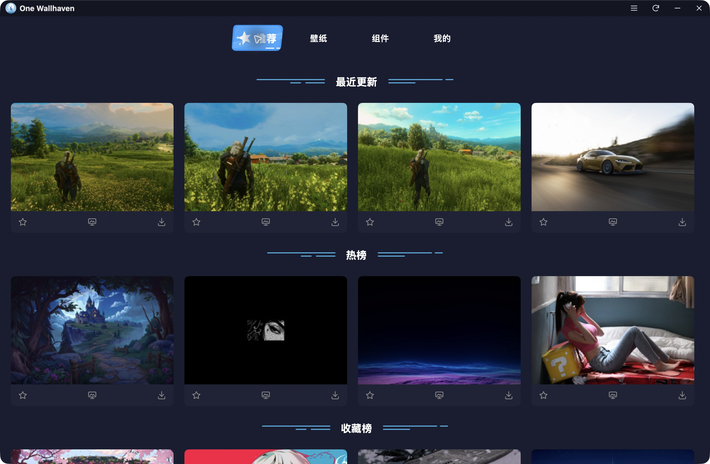
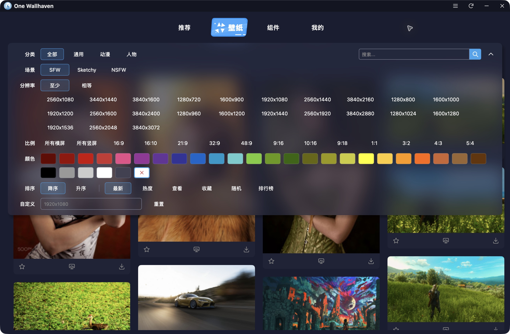
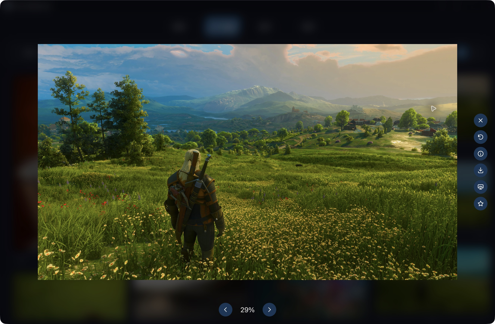

<h1 align="center">MyGO Wallhaven</h1>

<div align="center">一款基于 Go / MyGO 原生 UI 的壁纸客户端。</div>

## 运行

```sh
go mod download # 安装依赖
make dev        # 开发
make check      # 检查
make build      # 打包
```

自动更新与 GitHub Releases 发布配置见 [发布说明](docs/releases.md)。

## 截图







## API

[Wallhaven API](https://wallhaven.cc/help/api)

## LICENSE

[MIT LICENSE](LICENSE)
