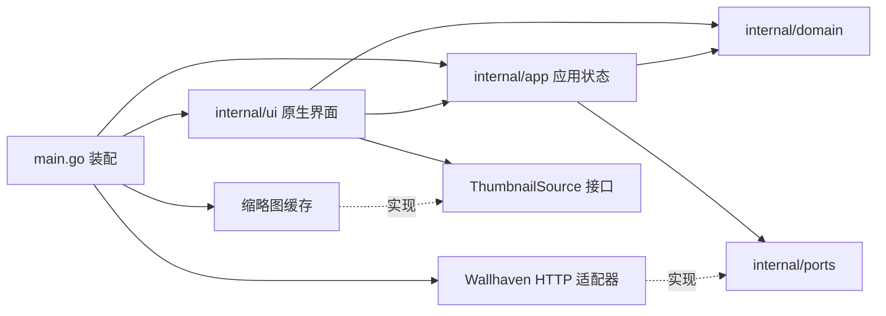

# MyGO 架构

## 当前定位

`mygo-wallhaven` 是原 `wallhaven-electron` 的 MyGO 原生重写工程。已实现推荐、搜索筛选、分页、可见区域缩略图、应用内详情、本地收藏、原图下载、macOS 设置壁纸及原版三项设置；剩余业务进度见 [功能清单](legacy-features.md)。

本轮参考本机 `/Users/yykj/Desktop/vibe-code/octo-lite` 的 `go.mod`、`main.go`、`docs/architecture.md` 与 `.agents/skills/mygo-maintenance/SKILL.md`。采用相同的 MyGO 原生 UI 路线和依赖方向，没有引入聊天、认证、WebView 内容桥接或 OCTO 服务依赖。

## 技术基线

- Go：`1.27.3`，与本机已安装工具链及 `octo-lite` 保持一致。
- MyGO：`github.com/egoist/mygo v0.8.4-0.20261110122622-96334a46826e`，固定到与参考工程相同的官方提交。
- UI：`github.com/egoist/mygo/ui` 原生界面，通过 `ui.View` 交给窗口绘制。
- 工具：在 `go.mod` 声明 `github.com/egoist/mygo/cmd/mygo`，使用 `go tool mygo` 开发、检查与构建。
- 配置：`mygo.json` 保存应用名称、标识、版本和构建输出目录。
- 当前工程不需要 Node、Electron、Vue 或前端构建命令。

使用官方模块及 Go 校验和，未复制 `octo-lite` 的项目补丁、生成的 `go.work`、`.mygo/deps` 或本机绝对路径依赖。当前基础工程不依赖其聊天专用修补逻辑；后续确需补丁时，应独立记录来源、适用版本及验证，不改写共享模块缓存。

## 已建立的目录与依赖

```text
main.go                         应用生命周期与窗口装配
mygo.json                       MyGO 应用配置
go.mod / go.sum                 固定依赖和 CLI 工具
internal/
  domain/                       页面、壁纸、搜索参数及验证，不依赖 UI 框架
  ports/                        壁纸来源、收藏存储、原图文件和桌面壁纸接口
  app/                          推荐／搜索状态，以及收藏／文件操作的异步状态和代次保护
  adapters/wallhaven/            官方搜索 API 与 HTTP 契约测试
  adapters/images/               有容量限制的异步缩略图缓存
  adapters/storage/              版本化JSON收藏／设置与原子保存
  adapters/files/                原图流式下载、校验及原子发布
  adapters/desktop/              macOS AppKit 壁纸、MyGO登录项与下载目录适配
  ui/                           原版布局、筛选和可见区域瀑布流
docs/
  legacy-features.md            原功能证据、缺口及迁移清单
  architecture.md              本文
```



`main.go` 装配 Wallhaven 适配器、Controller、图片缓存与窗口。Controller 后台执行请求，结果经 `Window.Update` 回到 UI 线程；UI 只读取状态和提交用例。`ui` 与 `app` 均不直接依赖 HTTP 适配器；领域模型不引用框架。`ThumbnailSource` 是 UI 使用的窄接口，由图片缓存实现。

四组推荐并行且分别保存加载／失败状态。搜索快照保存已提交的筛选条件，草稿输入由 UI 持有；分页始终沿用已提交条件。新搜索、刷新或关闭会取消旧任务；所有结果提交时再次检查上下文及请求代次。生产装配启用 `Prefetch`，仅在第一页成功后预取第二页；后续在距离列表末尾不足1.5屏或1000px时自动请求，按 ID 去重并在末页停止。页尾保留加载动画位置，失败停止自动请求并支持重试原页。页面切换保留现有结果和滚动状态。

图片缓存由八个 worker、有限队列和约 64MB 的 LRU 管理。HTTP 响应及图片尺寸有限制，失败有重试冷却。可见区域请求优先于附近图片预取；预取最多占用两个 worker，可见请求可以提升已排队的预取任务。推荐在可见条带预取后续两张，搜索在附近滚动区域预取。壁纸瀑布流及其附近预取、大图预览优先使用保留完整比例的 orig 缩略图；仅在该地址缺失时回退已有预览地址。瀑布流卡片高度按原图宽高比计算，不设最低高度；壁纸普通模式、首页推荐及其预取使用 small 缩略图，Cover 铺满原版300×200固定卡片。图片来源与填充方式共用同一模式判断，切换模式后同步改变显示和预取来源。收藏固定卡片容器内使用 Contain 完整展示。UI 按搜索状态版本复用私有快照，按查询代次和宽度复用瀑布流位置，追加页面只计算新增卡片。后台只发布图片并请求重绘，不保存控件或 Context。窗口关闭与应用退出均关闭 Controller 和缓存。

详情通过独立可选端口 `WallpaperDetails` 获取，由同一个 Wallhaven 适配器实现，不改变搜索端口。Controller 维护选中壁纸与详情快照，打开新图、关闭或切页时取消旧元数据请求，并在 UI 提交时复核代次。原图加载由独立 `DetailLoader` 在后台完成，UI 通过窄接口使用不可变 Bitmap；传输上下文、选中 ID 与请求代次共同防止旧图片覆盖新选择。UI 只保存原图、缩放／平移等展示状态，不保存构建期 Element 或 Context。

预览打开时关联来源列表：搜索复用当前查询代次与分页状态，推荐显式记录分组及刷新代次，收藏保存打开时的私有列表快照。上一张／下一张按钮和预览内的键盘 ←／→ 共用 Controller 的切换入口；到已加载列表末尾自动请求下一页，搜索共享正在进行的预取，推荐继续同一排序分组，结果追加到来源列表并按 ID 去重。等待期间的多次下一张只排队一次切换；上一张、关闭或重新打开会清除等待。失败保留当前图片并支持重试原页，末页停止；更换查询或刷新推荐会关闭对应旧预览，迟到页面不能重新打开或改变新选择。

原图加载器最多同时传输／解码一张图片，不写磁盘；与下载器共用64MiB上限的编码原图 LRU，缓存成功解码的原始字节，命中时下载直接校验并写入，不重复 GET 或重编码。默认限制60秒、64MiB编码大小、64M像素和32768单边尺寸；像素转换与 GPU mipmap 仍可能增加瞬时内存，不将缓存限制视为总进程内存上限。原图或详情请求可以单独失败、重试，保留列表状态和已经取得的图片。

`Actions` 独立维护本地收藏与文件操作，仍只在 UI 线程读写状态，所有I/O均在后台经 `Dispatch` 回传。收藏先完成持久化再更新星标，加载失败或保存失败不丢弃现有数据；UI按 `LibraryRevision` 复用私有快照。文件操作按“类型＋壁纸ID”拒绝重复提交，最多3个并行，其余排队；进度回传节流，速度按实际时间计算。暂停／取消等待后台停止后才允许继续，使用上下文原因与代次拒绝迟到结果。页面切换或关闭预览不会中断下载；退出中断传输并保存暂停状态，重启不自动发起下载，继续时保留任务原目录。

`Preferences` 管理预览模式、开机启动与下载目录的异步加载／保存／应用，状态只在 UI 线程提交。设置保存成功后更新搜索布局和 `Actions` 的新下载目录，保存中禁止重复提交；已提交的下载保留提交时的路径，设壁纸的稳定原图目录不变。普通模式为 small 缩略图铺满300×200卡片的等高平铺，瀑布流使用保留原图比例的缩略图；切换时重建布局并回到列表顶部，收藏仍固定平铺。

下载页目录入口与独立设置共用 `Preferences` 和原生目录选择回调；空任务队列仍显示入口，取消不改设置，保存／验证失败在当前页显示。任务同时显示累计已下载／总大小与百分比，活动任务额外显示速度，暂停后不显示活动速度。

设置写入用户数据目录的 `settings.json`，版本1、32KiB上限、0600权限，同目录临时文件同步后原子替换；损坏或未知版本禁止覆盖。目录选择使用 MyGO 原生文件夹对话框，取消不修改设置，保存前验证目录存在且可写。开机启动通过 `MyGO.App.SetOpenAtLogin`／`OpenAtLogin` 接系统接口，保存前核对实际结果，保存失败或取消时尝试恢复原登录项；恢复失败明确报告并显示实际系统状态。启动及设置窗口获得焦点时只读取系统状态，不根据旧文件重新注册登录项。目录对话框引起的焦点变化不抢占其保存操作。登录项的成功、拒绝和回滚使用注入端口验证，未进行实际注销／重新登录验收。

收藏与下载历史分别采用版本化 JSON，限制16MiB／10000条，缺失文件视为空，损坏或未知版本报错并禁止覆盖；同目录临时文件同步后原子重命名。历史包含目标目录、任务状态、完成时间和路径，保存失败显示错误并可重试。删除记录与清空完成记录只清理自己的断点与未发布临时文件，不删除已下载原图。

`DownloadResumable` 将哈希任务标识对应的侧车保存在 `download-state`，私有 `.part` 留在目标目录；同标识调用串行，恢复以实际文件长度发送 Range／If-Range。206 必须核对范围和校验信息，200 安全重开，416 只有长度及完整图片验证通过才完成，无可靠校验信息时不拼接。完成后保留文件哈希凭据，覆盖“原图已发布但应用未收到完成回调就退出”的边界。原图按真实格式、尺寸和完整解码校验后原子发布，不覆盖已有文件，重名追加序号。下载默认系统下载目录的 `MyGO Wallhaven` 子目录；设壁纸原图保存在稳定用户数据目录。

macOS 壁纸适配通过固定 JXA 脚本调用 `NSWorkspace.setDesktopImageURL:forScreen:options:error:`，路径作为独立参数传入，逐个设置当前连接屏幕，不承诺覆盖其他Space。Windows 使用 `SystemParametersInfoW` 持久化并广播变更；Linux 根据桌面选择 gsettings（GNOME／Cinnamon／MATE）、xfconf-query（XFCE）或 gdbus（Plasma），校验工具、配置与写入结果。GNOME／Cinnamon 的图片模式为 none、MATE 背景开关关闭、XFCE 样式为 NONE 时启用图片并读回验证，保留其他已有样式。未知桌面、缺少工具、策略拒绝和超时明确失败；没有通用 Portal 后备。文件位置通过 MyGO `Shell.ShowItemInFolder` 展示。平台测试注入调用器，不修改当前桌面；Windows／Linux 尚未实机验收。

应用使用原版无边框窗口、30px 自绘标题栏和80px 顶部导航；选中项按原蓝色卡片风格用原生矢量和文字重绘，替代96×48位图在高分屏上的放大。没有侧栏或新设计的页面大标题。“组件”保留原版未完成入口，“我的”对应收藏，下载和设置移回功能菜单。启动前注册 `OnSecondInstance` 并申请 MyGO 单实例锁；第二次启动退出，由原进程恢复、显示和聚焦窗口，窗口尚未创建时延迟唤起。旧版关闭隐藏和托盘尚未迁移，关闭按钮目前退出应用。

## UI 视觉基线

参考 Git 原版提交 `abcece9b5cd9af820e190e7c5e091f6fd6219e0d` 的组件、CSS 和素材；不重新设计产品界面。原 README 的远程截图无法读取，因此本轮按源码尺寸和颜色核对，不宣称与远程截图逐像素一致。

| 区域 | 原版约束与当前实现 |
| --- | --- |
| 外壳 | 1300×800 初始尺寸，无边框；标题栏30px、顶部导航80px，保留用户已有窗口尺寸恢复 |
| 导航 | 推荐／壁纸／组件／我的；94px 导航项、20px 间距，96×48选中卡片使用矢量背景／品牌符号及原生文字 |
| 配色 | 默认深色背景 `#191d30`、筛选 `#292e47`、卡片栏 `#1e2336`；浅色按原变量恢复 |
| 推荐 | 居中20px装饰标题；300×200图片、40px操作栏、20px间距、8px圆角；按用户要求去掉左右箭头，保留横向滚动 |
| 搜索 | 80px占位、分类靠左、搜索框靠右；展开时覆盖结果区，筛选项按可用宽度排列、面板高度随内容收缩 |
| 列表 | 300px固定列、20px间距、最短列瀑布流；所有图片高度按原图比例计算，缺失尺寸时回退200px；元数据悬停展示 |
| 菜单 | 下载／皮肤／设置／日志／关于；三列等宽、10px间距，图标文字居中；功能图标统一为线性矢量图标，保留原皮肤预览图 |
| 设置 | 原版独立450×340无边框窗口、深色背景、4px蓝框与竖分隔线、100px标签；原生开关、目录选择和打开文件位置；macOS窗口与内容共用16DIP连续圆角、透明底，其他平台保持直角 |

原素材从 Git 恢复到 `internal/ui/assets/legacy`，保留原 logo、皮肤预览及空状态素材，不恢复 Electron 或 Vue 运行时。导航沿用亮蓝底、斜向高光、底部白色短条，以及星光／风车／拼图／UP符号；背景和符号由MyGO原生SVG绘制，中文字独立使用原生文字，不进行斜切或位图缩放。原导航PNG保留但不再解码使用。功能图标按用户要求统一为24单位画布、1.85单位描边、圆角端点与连接的线性SVG，通过 MyGO `Icon` 原生绘制并继承控件文字颜色；标题栏16px、常规和详情按钮18px、菜单24px；详情圆形按钮36px，其他按钮点击区域保持原尺寸。旧字体和功能位图资产保留，但不再用于功能图标绘制。卡片与详情操作栏接通收藏、原图下载和设置壁纸；进行中的操作禁用重复提交，保存和系统接口成功后才显示完成。

筛选标签垂直居中，各行选项左侧对齐；分辨率、比例和颜色根据可用宽度显式分行，减少固定小组留下的空白。选项使用软蓝底和细边框区分选中状态，色块保持本色并使用对比色矢量勾选；面板按内容高度收缩，小窗口限制高度并在内部滚动，展开不改变结果区尺寸。详情沿用原版遮罩、居中原图、右侧圆形按钮和底部缩放比例；按用户要求，上一张／下一张按钮放在底部缩放比例两侧，背景页面在预览打开时使用 MyGO 原生12DIP高斯模糊，大图与操作控件独立绘制并保持清晰。预览缩略图和原图共用按大图尺寸计算的显示区域，原图完成后通过180ms淡入过渡显示。右侧工具栏悬停提示显示在按钮左侧，底部翻图提示显示在按钮上方；提示背景、文字和边框采用当前主题配色。信息面板默认收起，通过信息按钮展开。交互输入使用原生事件与独立画布，重试等控件不放在捕获手势的画布子树内。

图片完成后台加载后使用 MyGO 原生过渡淡入；直接命中缓存的图片立即显示，避免滚动或调整窗口时重复等待。卡片悬停信息和阴影、高级筛选高度、详情信息面板使用短过渡，图片点击不显示“查看壁纸详情”悬停提示。

`legacy_fidelity_test.go` 直接断言来源于旧 CSS 的标题栏、导航、卡片和图片尺寸，验证筛选展开不改变列表尺寸、深浅背景色、皮肤弹窗位置、窗口按钮，以及页面返回后的图片加载。浅色／深色和最小窗口截图已检查，实际 macOS 进程已核对原生搜索与真实数据。

## 后续业务的扩展位置

下表区分已接通的层次与后续扩展；未完成模块没有返回成功的占位实现。

| 位置 | 后续责任 |
| --- | --- |
| `internal/domain` | 已实现壁纸、筛选参数、文件任务状态与三项设置值／校验 |
| `internal/app` | Controller负责浏览，Actions负责收藏／下载／壁纸，Preferences负责设置加载／保存／应用 |
| `internal/ports` | 壁纸来源、收藏／设置存储、原图下载、桌面壁纸、登录项和下载目录接口 |
| `internal/adapters/wallhaven` | 已实现 Go HTTP 请求、参数编码、响应转换与错误处理 |
| `internal/adapters/images` | 已实现异步缩略图解码、缓存、去重和关闭取消 |
| `internal/adapters/storage` | 已实现收藏／设置／任务历史持久化；旧 Electron 数据兼容未实现 |
| `internal/adapters/files` | 原图传输、断点／校验／完成凭据、编码原图缓存与私有临时文件清理 |
| `internal/adapters/desktop` | macOS／Windows／指定 Linux 桌面壁纸、MyGO登录项与下载目录；跨平台实机验收仍待完成 |
| `internal/ui` | 原生页面、图片列表、预览和交互状态，不直接执行网络、数据库或系统壁纸操作 |

目标依赖为 `ui → app → ports/domain`，由 adapters 实现 ports，`main.go` 装配。接口随实际用例加入，保持基础工程规模与当前需求一致。

## UI 生命周期

按固定版本的 `ui/doc.go` 和参考工程维护规范执行：

1. 页面状态保存在 Controller 或 UI 的普通 Go 字段中。不要跨构建保存 `ui.Element`、临时控件部件或 `*ui.Context`。
2. 页面与导航控件在构造前使用稳定的 `c.Key(...)`；页面离开、返回以及同一事件的多轮构建均保持明确身份。
3. 修改页面等动作通过 `OnClick` 执行；渲染函数只根据当前状态声明界面，不在每次构建中启动外部副作用。
4. HTTP 和图片解码在后台执行；搜索结果通过 `Window.Update` 在 UI 线程提交，图片缓存完成后调用 `Invalidate` 请求重绘。后者不用于同步 UI 状态写入，后续磁盘任务也遵循此边界。
5. 后台任务不持有 Context 或 Element；需要长期保留的系统服务回调使用 `c.Services()`。通过取消上下文或请求代次丢弃已经切换条件／关闭窗口后的迟到结果。
6. 图片列表的缓存、控件状态与壁纸 ID 绑定，不能用每次刷新变化的序号代替持久身份。

## 迁移时需要重新验证的边界

- Wallhaven 访问统一收敛到 Go 适配器；当前采用进程环境变量配置 API Key，不持久化。后续新增设置入口时须明确保存方式和服务授权范围，避免密钥出现在日志或 UI 快照中。
- 下载状态和恢复信息独立于控件存在；恢复必须核对本地临时文件和服务端响应，不能把“发送恢复调用”当作恢复成功。
- 使用 `filepath` 和各平台实现处理路径与系统能力。未支持的平台必须返回明确结果，不能返回假成功。
- 设置加载、保存和应用分别处理。主题、预览模式、开机启动等都需要验证重启后的行为。
- 旧版 electron-store 数据不自动读取、修改或删除；格式兼容迁移不在本轮范围内。

当前 API Key 仅从 `WALLHAVEN_API_KEY` 环境变量读取，通过 `X-API-Key` 请求头发送，不进入查询快照。适配器拒绝向不同来源重定向凭证，限制响应大小，并分别显示访问拒绝、限流、超时、连接失败及非法响应等错误。搜索参数经结构化编码；随机查询保留第一页种子，服务端稳定性限制见 README。

## 验证方式

```sh
CGO_ENABLED=0 go test ./...
go test -race ./internal/...
go tool mygo vet .
CGO_ENABLED=0 go build ./...
make build
```

UI 测试通过 `ui.NewTester` 操作真实原生控件，覆盖关键词回车提交、分类与等级、精确分辨率、多选比例、颜色、排序、重置、翻页、错误重试、可见图片加载、页面反复返回、额外构建帧与最小尺寸。可导出浅色／深色合成图片截图。显式启用的 `TestLiveCatalog` 验证真实搜索、第二页预取和缩略图解码，并可导出真实结果截图。

当前运行验证平台为 macOS / arm64；另通过 Windows／Linux amd64 的纯 Go 交叉编译，其他操作系统仍需在各自桌面环境实机验收。实际检查结果与命令入口见根目录 README。

开发使用 `make dev`，构建使用 `make build`，两者都显式携带 `-sign -`。`mygo.json` 也设置 `macos.signingIdentity=-` 作为构建默认值，但当前 CLI 开发模式仍会自动查找证书，因此必须保留启动参数。签名约束同时记录在根目录 `AGENTS.md`。
